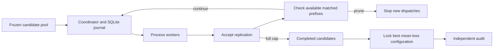

# Aster

**Parallel hyperparameter optimization for noisy simulations, with adaptive replication and recoverable experiments.**

[Results and evidence](docs/RESULTS.md) · [Reproduce the study](docs/BENCHMARKING.md) · [Runtime guarantees](docs/RUNTIME.md) · [Roadmap](ROADMAP.md)

[Native CPU and CUDA tools](docs/NATIVE.md): optional C++20 batch/streaming accounting,
strict NumPy bindings, and a standalone A100 correctness/benchmark package.

[](https://github.com/kenchengkc/aster-hpo/actions/workflows/ci.yml)
[](LICENSE)

Aster allocates repeated evaluations across a frozen pool of configurations. It runs
simulations in parallel and stops allocating work to candidates whose matched outcomes
look worse than their peers. Independent training seeds capture initialization noise;
shared scenario seeds support paired comparisons of exogenous simulation noise.

In a **20-seed CPU neural-hedging study**, replication racing used **52.3% fewer
replications** and achieved a **1.43× median paired search speedup** versus full-budget
search with the same four workers. Both methods selected the same configuration in
20/20 runs, giving identical independent audit outcomes. This is observed agreement
on one synthetic market using the recorded v0.2 runtime; the zero-variance comparison
does **not** establish a general quality-preservation guarantee.
[Protocol, raw evidence, limitations →](docs/RESULTS.md)


## Upgrade progress

**Current development version: 0.3.0.** The original six-step research/runtime
upgrade is implemented. The subsequent resource-control phase is also complete;
broader benchmarking and scaling work remains on the [roadmap](ROADMAP.md).

| Upgrade | Status | Delivered |
| --- | --- | --- |
| 1. Scheduler correctness | Complete | Matched-prefix comparisons reconsidered when peers finish; already running pruned work retains its outcome and cost. |
| 2. Noisy-simulation diagnostics | Complete | Heteroscedastic, near-tie, and heavy-tail cases, candidate-order checks, and shared/independent scenario comparisons. |
| 3. Recoverable local execution | Complete | Coordinator-owned SQLite journal, resume, bounded retries, duplicate/stale-result rejection, native thread controls, and attempt/worker telemetry. |
| 4. CPU financial workload | Complete | NumPy neural hedging with transaction costs, verified cash flows and gradients, and separate training/evaluation paths. |
| 5. Allocation and quality study | Initial study complete | `FullBudget`, single-bracket stopping `ASHA`, and heuristic `ReplicationRace`; locked winners and independent audits across 20 optimizer seeds. [Evidence](docs/RESULTS.md). |
| 6. Package, documentation, and review | Complete | Installable package, runnable examples, technical report, raw artifacts, figures, and regression tests. |
| Resource controls (v0.3) | Complete | Per-invocation wall/attempt budgets, evaluation timeouts, caller cancellation, and supervised worker cleanup. [Runtime contract](docs/RUNTIME.md#resource-limits-in-v03). |
| Native performance foundation | CPU implementation and CUDA test package | C++20 accounting and streaming ledger, optional Python companion, separate native/API/objective measurements, and GPU validation commands. [Guide](docs/NATIVE.md). |

The core has no required dependencies; numerical, plotting, and reference-baseline
packages are optional. Replications use stable seeds, with disjoint search and audit
namespaces. CI is configured for Linux/macOS and Python 3.11–3.13.

## Quick start

Requires Python 3.11+. Run these commands from a repository checkout:

```bash
git clone https://github.com/kenchengkc/aster-hpo.git
cd aster-hpo
python -m venv .venv
source .venv/bin/activate
python -m pip install -e '.[dev,benchmark]'
python examples/noisy_quadratic.py --workers 2
python -m examples.budgeted_search --output results/budget-demo
python -m examples.hedging --output results/hedging-pilot
```

The quadratic example is a functionality demonstration: its cheap objective does not
measure useful parallel speedup. The budget example stops a CPU simulation search and
resumes the same SQLite study; [recorded exports](docs/evidence/runtime-2026-09-26/README.md)
show committed observations preserved across sessions. The hedging example is a disjoint
pilot; follow the [benchmark protocol](docs/BENCHMARKING.md) to freeze and execute a comparison.
Research modules live in the checkout; the installable wheel contains the core library.

## Library usage

```python
import random

from aster_hpo import Float, ReplicationRace, Study, audit, sample_configs


def objective(config, replication):
    scenario = random.Random(replication.scenario_seed).gauss(0, 0.1)
    training = random.Random(replication.training_seed).gauss(0, 0.02)
    return (config["x"] - 0.25) ** 2 + scenario + training


if __name__ == "__main__":
    configs = sample_configs({"x": Float(-2, 2)}, count=16, seed=17)
    study = Study(
        configs,
        scheduler=ReplicationRace(checkpoints=(3, 9, 27)),
        workers=4,
        seed=17,
        storage="results/search.sqlite",
        objective_id="quadratic-with-training-noise-v1",
        max_retries=1,
        threads_per_worker=1,
    )
    result = study.optimize(objective)

    if result.best_trial is not None:
        checked = audit(
            objective,
            result.best_trial.config,
            replications=100,
            seed=17,
            storage="results/audit.sqlite",
            objective_id="quadratic-with-training-noise-v1",
        )
        print(result.best_trial.config, checked.mean, checked.standard_error)
```

Objectives return one finite scalar loss; lower is better. Use a top-level callable
and a main guard for process execution. Running the same persistent study again
resumes committed observations. Change `objective_id` when the objective, data, or
simulation contract changes. See [recovery semantics](docs/RUNTIME.md).

### Limit a session and resume

Replace the `optimize` call inside the main guard above with:

```python
from aster_hpo import RunBudget

partial = study.optimize(
    objective,
    budget=RunBudget(max_wall_seconds=60, max_attempts=100),
)
print(partial.metadata["termination_reason"])
# Reuse committed progress with a fresh allowance for this invocation.
result = study.optimize(objective, budget=RunBudget(max_wall_seconds=120))
```

An attempt cap includes retries and drains admitted work. A wall limit stops active
managed workers and leaves unfinished trials resumable. A partial result may have no
winner: only candidates that reach the full replication cap are eligible. Per-evaluation
timeouts and `CancellationToken` are also available; see the
[stop and resume semantics](docs/RUNTIME.md#stopping-and-resuming).

## How allocation works



`FullBudget` gives every candidate the same cap. `ASHA` stops candidates using prior
rung ranks. `ReplicationRace` uses paired mean differences and standard-error margins
at configurable checkpoints. Completed candidates can supply comparison prefixes;
pruned and failed peers cannot. Selection considers completed candidates at a common
cap. [ASHA reference semantics →](docs/BASELINES.md)

## Statistical and engineering limits

The racing boundary is a **heuristic**, not a confidence sequence or a repeated-testing
guarantee. Near-tie diagnostics include runs where it prunes the true optimum.
`audit()` provides descriptive statistics; the research runner adds paired analysis
across independent optimizer seeds, with explicit incomplete, insufficient, and
zero-variance outcomes.

Execution is local, with at most one replication in flight per candidate. There is
no cluster executor or measured CPU-time cap. Wall limits and cancellation preempt
managed workers; OS scheduling, coordinator operations, and cleanup add latency.
They do not control arbitrary subprocesses or external services created by objectives.
Recovery provides exactly-once acceptance, while interrupted objectives may execute
again. CPU cost of unreturned work remains unknown. Native thread controls do not
make numerical results bitwise portable across hardware, and asynchronous completion
can change pruning decisions.

The financial workload uses a small policy in a synthetic GBM market. Results do not
measure live trading performance, stochastic-volatility robustness, or superiority
to complete Ray Tune or Optuna workflows.

## Development and further work

```bash
python -m pytest -q
ruff check .
ruff format --check .
python -m build
# Optional compatibility test against pinned Ray:
python -m pip install -e '.[baseline]'
python -m pytest tests/test_asha.py -q
```

### Remaining upgrades

1. **Keep workers busy as candidates are pruned:** support bounded concurrent
   replications per candidate while preserving checkpoint decision boundaries.
2. **Compare complete external workflows:** benchmark Ray Tune and Optuna TPE,
   separating proposer, scheduler, and runtime differences. Current Ray coverage
   validates ASHA decisions only; see [baseline scope](docs/BASELINES.md).
3. **Broaden the research evidence:** prespecified equal-wall-budget and equal-compute
   studies, larger candidate pools, harder rankings, additional hardware, and financial
   stress tests.
4. **Extend resource accounting and execution:** measured CPU-time budgets and durable
   multi-machine coordination.
5. **Refresh public presentation:** update the project website with the current
   runtime, financial evidence, and reproducibility instructions.

These are remaining directions, not implemented features or promised release dates.
The [roadmap](ROADMAP.md) lists additional runtime and research extensions.
[DESIGN.md](DESIGN.md) retains the broader target architecture. The existing
[project website](https://aster-hpo.vercel.app) presents an earlier synthetic smoke
snapshot; the repository report above is the current evidence.

Research foundations: [ASHA](https://arxiv.org/abs/1810.05934),
[common random numbers](https://arxiv.org/abs/1910.09259),
[Deep Hedging](https://arxiv.org/abs/1802.03042), and
[confidence sequences](https://arxiv.org/abs/1810.08240).
These works motivate the project; their algorithms and results are not claimed as original.

Maintained by Ken Cheng. Licensed under the [MIT License](LICENSE).
