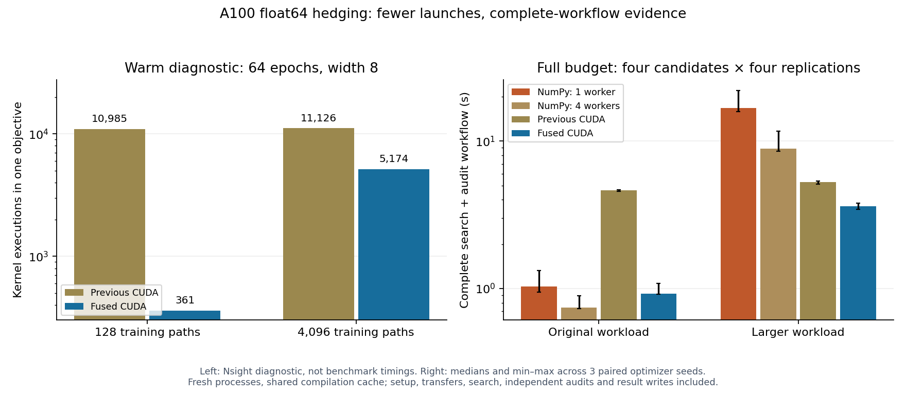
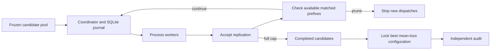

# Aster

Aster is a Python library for parallel hyperparameter optimization of stochastic
simulations. It combines adaptive replication, recoverable experiment execution,
and independent evaluation of selected configurations. Optional C++20 and CUDA
components provide native accounting and GPU execution for neural hedging with
transaction costs.

[](https://github.com/kenchengkc/aster-hpo/actions/workflows/ci.yml)
[](LICENSE)

[Project website](https://aster-hpo.vercel.app/) · [CPU study](docs/RESULTS.md) · [CUDA study](docs/evidence/cuda-launch-2026-11-04/README.md) · [Runtime guarantees](docs/RUNTIME.md) · [Roadmap](ROADMAP.md)

Aster allocates repeated evaluations across a frozen pool of configurations. It runs
simulations in parallel and stops allocating work to candidates whose matched outcomes
look worse than their peers. Independent training seeds capture initialization noise;
shared scenario seeds support paired comparisons of exogenous simulation noise.

## Implementation status

The current development version is **0.3.0**. The Python core has no required runtime
dependencies. Numerical libraries, the C++ companion, CUDA, plotting tools, and
reference-baseline packages are optional.

| Component | Status | Implementation |
| --- | --- | --- |
| Search and replication allocation | Implemented | Typed candidate sampling, `FullBudget`, single-bracket stopping `ASHA`, and heuristic `ReplicationRace` with matched-prefix comparisons. |
| Recoverable execution | Implemented | Coordinator-owned SQLite journals, resume, seed-preserving retries, duplicate/stale-result rejection, and native thread controls. |
| Resource controls | Implemented | Per-invocation wall/attempt budgets, evaluation timeouts, caller cancellation, and bounded cleanup of owned workers. |
| C++20 accounting | Implemented and validated | Float64 batch accounting, allocating and preallocated NumPy bindings, and a streaming ledger. |
| CUDA simulation and training | Implemented and benchmarked | Resident simulation, policy training, evaluation, and independent audits through the regular HPO pipeline; fused kernels reduce launch overhead. |
| Persistent worker pools | Implemented; **performance study pending** | Managed process reuse across searches and audits. The repeated-workflow benchmark package is prepared, but no comparative performance results are available. |

## C++20 and CUDA backends

### Native accounting

The optional `aster_hpo_native` companion calculates hedge P&L, transaction costs,
and turnover, including opening, rebalancing, and liquidation. `hedge_pnl` allocates
NumPy output arrays; `hedge_pnl_into` writes to caller-provided arrays. `Ledger`
provides chronological accounting without heap allocation during successful native
updates; Python bindings and returned Python objects have their own overhead.

Bindings require aligned, C-contiguous NumPy float64 inputs and reject incompatible
layouts or dtypes without implicit conversion. They validate output-buffer overlap
and release the Python interpreter lock during native work. The companion is
separate from the optimization core and from the NumPy reference used in the
CPU/CUDA workflow comparison below.

The [native API guide](native/README.md) documents ownership and error handling.
The [measurement guide](docs/NATIVE.md) distinguishes prepared kernels, checked
native calls, Python calls, streaming updates, and complete objectives. Component
timings do not establish a C++ speedup for the complete HPO workflow.

### Resident CUDA execution

The optional CuPy/CUDA backend runs price simulation, neural-policy training, and
policy evaluation with resident float64 arrays. Matched NumPy random shocks and
initialization are uploaded once per objective; prices, positions, gradients, optimizer state,
and per-call scratch buffers remain on the device. Final scalar metrics return to
the coordinator for journaling and selection.

The optimized `cuda` trainer combines finite checks, gradient-norm calculation,
clipping, and Adam into one kernel per epoch. Batches with at most 512 training
paths and policy width at most 64 additionally combine forward evaluation,
accounting/error, and gradients/loss, giving four training kernels per epoch.
Larger shapes retain CuPy/cuBLAS gradients. The previous trainer remains available
as `cuda_eager` for numerical and performance comparisons. NumPy is the default
backend; single-GPU experiments use one objective worker.

See the [CUDA workflow guide](docs/CUDA_WORKFLOW.md) for integration with `Study`
and `audit`, and the [standalone CUDA package](cuda/README.md) for accounting
correctness checks, Compute Sanitizer runs, and transfer measurements.

## Benchmark results

### CPU replication allocation

In the September 2026 study on an Apple M5, replication racing used **52.3% fewer
replications** and achieved a **1.43× median paired search speedup** relative to
full-budget search with the same four workers. The comparison used 20 optimizer
seeds, six candidate configurations per seed, and a cap of nine replications.
Search timing includes worker startup and journal writes; independent audits are
excluded from the speedup.

All methods selected the same configuration within each seed, producing identical
independent audit outcomes. This is observed agreement on one synthetic market.
The zero-variance paired comparison has no inferential bound and does not establish
a general quality-preservation or non-inferiority guarantee. Measurements use the
recorded v0.2 runtime, before persistent worker pools.


The [CPU report](docs/RESULTS.md) includes the timing definitions, corrected quality
analysis, raw evidence, and limitations. [Reproduction instructions](docs/BENCHMARKING.md)
provide the frozen protocol.

### Complete CPU/CUDA optimization workflow

The November 2026 comparison ran **42 fresh campaign processes** on one A100 PCIe
40 GB host, using three optimizer seeds and both full-budget and replication-racing
schedulers. The table reports **full-budget search plus independent audits**.
Each full-budget search evaluates four candidates with four replications each;
the selected configuration receives three independent audit replications. All CPU workers use one BLAS thread,
and audits use one worker.

| Workload | NumPy, 1 worker (s) | NumPy, 4 workers (s) | Eager CUDA, 1 worker (s) | Optimized CUDA, 1 worker (s) |
| --- | ---: | ---: | ---: | ---: |
| Small: 128 training / 2,048 evaluation paths | 1.032 | 0.742 | 4.625 | 0.923 |
| Larger: 4,096 training / 32,768 evaluation paths | 16.720 | 8.865 | 5.264 | 3.604 |

Both workloads use 64 training epochs and 12 trading intervals. Times are medians
across seeds. Speedups are calculated within each seed before taking the median,
so they need not equal ratios of the displayed times.

Optimized CUDA improves on the eager trainer by **4.96×** for the small workflow
and **1.46×** for the larger one. The larger workflow is **4.64× faster than one
NumPy worker** and **2.57× faster than four NumPy workers**. Four CPU workers are
faster on the small workload.

Workflow timing includes backend/context setup, numerical imports, host random-number
generation, transfers, simulation, training, evaluation, scheduling, SQLite journals,
winner selection, independent audits, and result writes. Campaigns have no objective
warmup, but share a compiler cache already populated by validation. The parent
process separately measures interpreter startup and exit: small optimized CUDA
then takes 1.165 s versus 1.124 s for one CPU worker, which is roughly parity.
These workflow results do not measure repeated use of a persistent worker pool.

A separate warmed Nsight diagnostic records **10,985 → 361 kernel executions** for
one small width-8 objective, a **96.7% reduction**. These counts describe launch
behavior; workflow speedups come from the unprofiled comparison above.

Across 594 accepted search evaluations and 126 audits, no objective failed. All
seven matched financial metrics passed `rtol=1e-6, atol=1e-8`, and the reported
winner/allocation pairs agreed. Three seeds on one host provide descriptive
engineering evidence without a general hardware, financial-quality, or tail-latency
guarantee.



The [CUDA report](docs/evidence/cuda-launch-2026-11-04/README.md) records source
revision `0d2e12b`, environment versions, process timings, validation, and reproduction
commands. [Workflow results](docs/evidence/cuda-launch-2026-11-04/summary.json) and
[profile counters](docs/evidence/cuda-launch-2026-11-04/profiles-summary.json) are
available as JSON.

### Standalone CUDA accounting

A separate A100 sensitivity experiment reused fixed price/holding inputs across
32 transaction-cost operations over 65,536 paths. Completed-session time decreased
from **26.41 ms to 4.42 ms**, a **5.97× median paired speedup** across three process
sessions. Timing includes input upload, all kernels, all result downloads, and
synchronization; GPU context and reusable-buffer setup are excluded.

This experiment measures accounting input reuse, rather than training, HPO, or
persistent-worker performance. The single-operation case was approximately unchanged
or slightly slower. The [resident accounting report](docs/evidence/cuda-resident-2026-11-04/README.md)
contains the complete workload matrix and timing boundaries.

## Persistent workers: performance study pending

**The `WorkerPool` API is implemented. The repeated-workflow performance study has
not run, and no persistent-worker speedup is reported.**

`Study.optimize(..., worker_pool=pool)` and `audit(..., worker_pool=pool)` can reuse
healthy owned processes across independent invocations. CUDA contexts, compiled
kernels, and allocator caches remain available; each hedging evaluation creates
fresh model parameters, random paths, and optimizer state. Each invocation receives
a fresh objective binding, and cancellation/timeouts retain the managed cleanup
contract.

Unbounded one-worker calls already run in the caller and retain CUDA caches within
that interpreter. The prepared comparison therefore includes direct execution,
fresh pools, and reused pools for CPU and CUDA, with four-worker CPU controls.
It reports the first workflow, later workflows, and complete sequence cost including
shutdown separately. Final packaged GPU validation must also be rerun on the next
compatible host.

The [worker-pool guide](docs/WORKER_POOLS.md) documents the API and lifecycle rules.
The [pending benchmark protocol](docs/PERSISTENT_BENCHMARK.md) specifies 48 coordinator
processes, each running three fresh search-and-audit workflows, for 144 planned
workflows. These are planned measurements, not completed results.

## Quick start

Python 3.11 or later is required. Run these commands from a source checkout containing the
0.3 runtime and the benchmark modules:

```bash
python -m venv .venv
source .venv/bin/activate
python -m pip install -e '.[dev,benchmark]'
python examples/noisy_quadratic.py --workers 2
python -m examples.budgeted_search --output results/budget-demo
python -m examples.hedging --output results/hedging-pilot
```

The quadratic example is a functionality demonstration: its cheap objective does not
measure useful parallel speedup. The budget example stops a CPU simulation search and
resumes the same SQLite study; [recorded exports](docs/evidence/runtime-2026-09-26/README.md)
show committed observations preserved across sessions. The hedging example is a disjoint
pilot; follow the [benchmark protocol](docs/BENCHMARKING.md) to freeze and execute a comparison.
Research modules live in the checkout; the installable wheel contains the core library.

### Optional native and CUDA installation

The C++ companion requires a C++20 compiler and CMake 3.20+. Install it from the
same source checkout:

```bash
python -m pip install ./native
```

On an NVIDIA development host with CUDA 13, install the CUDA dependencies and run
the financial pilot with one objective worker:

```bash
python -m pip install -e '.[benchmark,cuda13]'
python -m examples.hedging --backend cuda --workers 1 --configs 4 \
  --batch-paths 4096 --evaluation-paths 32768 \
  --output results/hedging-cuda-pilot
```

Use a fresh output directory. This pilot is separate from the comparative study.
The A100 evidence used CUDA 13.2 and CuPy 14.2.0; see the
[CUDA setup guide](docs/CUDA_WORKFLOW.md#install-and-run) for other compatible setups.
To run the frozen CPU/eager-CUDA/optimized-CUDA comparison:

```bash
python -m benchmarks.cuda_workflow run --include-eager \
  --output results/cuda-launch-comparison
```

## Library usage

```python
import random

from aster_hpo import Float, ReplicationRace, Study, audit, sample_configs


def objective(config, replication):
    scenario = random.Random(replication.scenario_seed).gauss(0, 0.1)
    training = random.Random(replication.training_seed).gauss(0, 0.02)
    return (config["x"] - 0.25) ** 2 + scenario + training


if __name__ == "__main__":
    configs = sample_configs({"x": Float(-2, 2)}, count=16, seed=17)
    study = Study(
        configs,
        scheduler=ReplicationRace(checkpoints=(3, 9, 27)),
        workers=4,
        seed=17,
        storage="results/search.sqlite",
        objective_id="quadratic-with-training-noise-v1",
        max_retries=1,
        threads_per_worker=1,
    )
    result = study.optimize(objective)

    if result.best_trial is not None:
        checked = audit(
            objective,
            result.best_trial.config,
            replications=100,
            seed=17,
            storage="results/audit.sqlite",
            objective_id="quadratic-with-training-noise-v1",
        )
        print(result.best_trial.config, checked.mean, checked.standard_error)
```

Objectives return one finite scalar loss; lower is better. Use a top-level callable
and a main guard for process execution. Running the same persistent study again
resumes committed observations. Change `objective_id` when the objective, data, or
simulation contract changes. See [recovery semantics](docs/RUNTIME.md).

### Limit a session and resume

Replace the `optimize` call inside the main guard above with:

```python
from aster_hpo import RunBudget

partial = study.optimize(
    objective,
    budget=RunBudget(max_wall_seconds=60, max_attempts=100),
)
print(partial.metadata["termination_reason"])
# Reuse committed progress with a fresh allowance for this invocation.
result = study.optimize(objective, budget=RunBudget(max_wall_seconds=120))
```

An attempt cap includes retries and drains admitted work. A wall limit stops active
managed workers and leaves unfinished trials resumable. A partial result may have no
winner: only candidates that reach the full replication cap are eligible. Per-evaluation
timeouts and `CancellationToken` are also available; see the
[stop and resume semantics](docs/RUNTIME.md#stopping-and-resuming).

## How allocation works



`FullBudget` gives every candidate the same cap. `ASHA` stops candidates using prior
rung ranks. `ReplicationRace` uses paired mean differences and standard-error margins
at configurable checkpoints. Completed candidates can supply comparison prefixes;
pruned and failed peers cannot. Selection considers completed candidates at a common
cap. [ASHA reference semantics →](docs/BASELINES.md)

## Statistical and engineering limits

The racing boundary is a **heuristic**, not a confidence sequence or a repeated-testing
guarantee. Near-tie diagnostics include runs where it prunes the true optimum.
`audit()` provides descriptive statistics; the research runner adds paired analysis
across independent optimizer seeds, with explicit incomplete, insufficient, and
zero-variance outcomes.

Execution is local, with at most one replication in flight per candidate. There is
no cluster executor or measured CPU-time cap. Wall limits and cancellation preempt
managed workers; OS scheduling, coordinator operations, and cleanup add latency.
They do not control arbitrary subprocesses or external services created by objectives.
Recovery provides exactly-once acceptance, while interrupted objectives may execute
again. CPU cost of unreturned work remains unknown. Native thread controls do not
make numerical results bitwise portable across hardware, and asynchronous completion
can change pruning decisions.

The financial workload uses a small policy in a synthetic GBM market. Results do not
measure live trading performance, stochastic-volatility robustness, or superiority
to complete Ray Tune or Optuna workflows.

## Development and further work

```bash
python -m pytest -q
ruff check .
ruff format --check .
python -m build
# Optional compatibility test against pinned Ray:
python -m pip install -e '.[baseline]'
python -m pytest tests/test_asha.py -q
```

### Remaining work

1. **Persistent-worker performance study:** run the prepared CPU/CUDA comparison
   on one compatible host, including fresh and reused pools, direct execution,
   first-run latency, and complete sequence cost.
2. **Concurrent replications per candidate:** support bounded concurrency while
   preserving checkpoint decision boundaries as candidates are pruned.
3. **External workflow comparisons:** benchmark Ray Tune and Optuna TPE, accounting
   for proposer, scheduler, and runtime differences. Current Ray coverage validates
   ASHA decisions only; see [baseline scope](docs/BASELINES.md).
4. **Broader financial and scaling studies:** evaluate larger candidate pools,
   harder rankings, additional hardware, and financial stress cases under
   prespecified wall-time and compute budgets.
5. **Resource accounting and distributed execution:** add measured CPU-time budgets
   and durable multi-machine coordination.

The [roadmap](ROADMAP.md) lists further runtime and research work;
[DESIGN.md](DESIGN.md) describes the broader target architecture. The
[project website](https://aster-hpo.vercel.app/) presents the current features,
architecture, and recorded CPU/CUDA evidence, with persistent-worker performance
marked as pending.

Research foundations: [ASHA](https://arxiv.org/abs/1810.05934),
[common random numbers](https://arxiv.org/abs/1910.09259),
[Deep Hedging](https://arxiv.org/abs/1802.03042), and
[confidence sequences](https://arxiv.org/abs/1810.08240).
These works motivate the project; their algorithms and results are not claimed as original.

Maintained by Ken Cheng. Licensed under the [MIT License](LICENSE).
