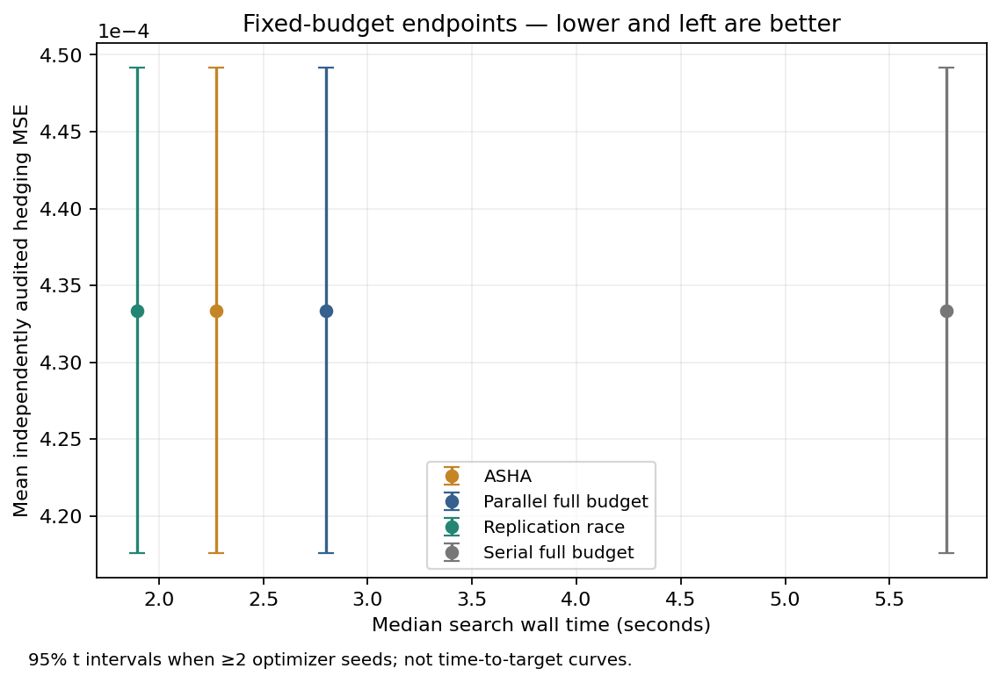
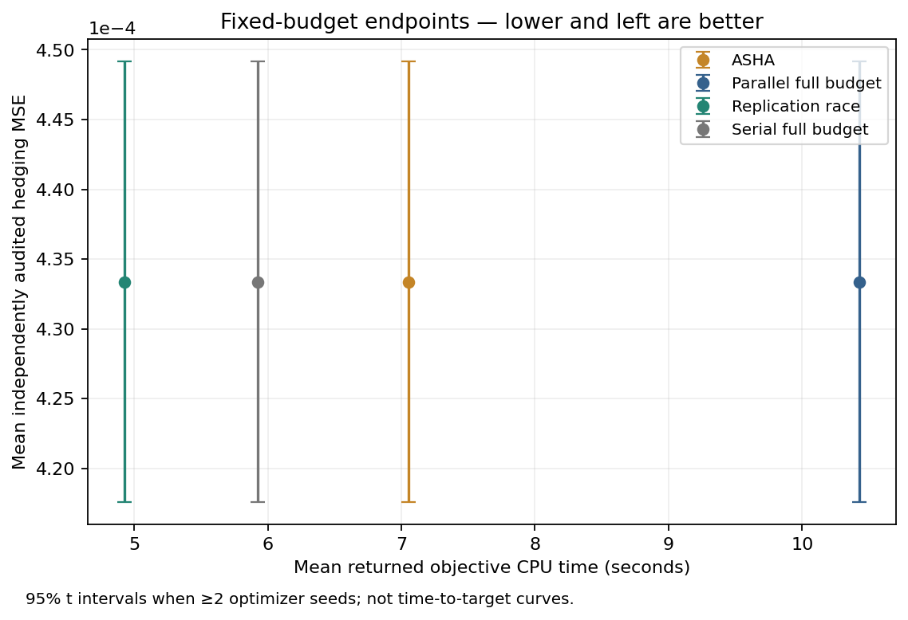
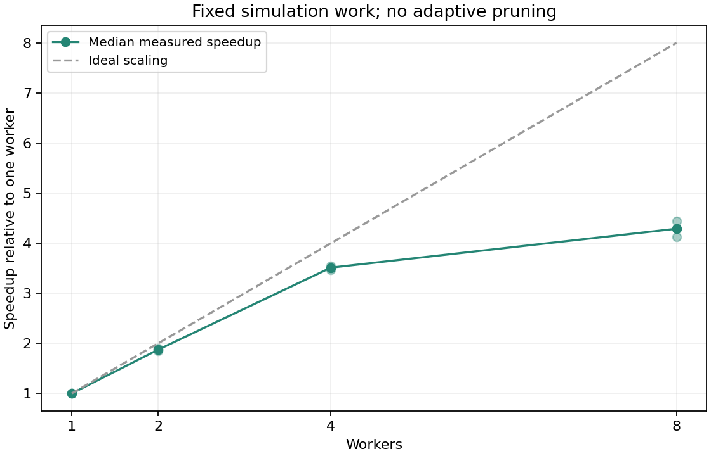
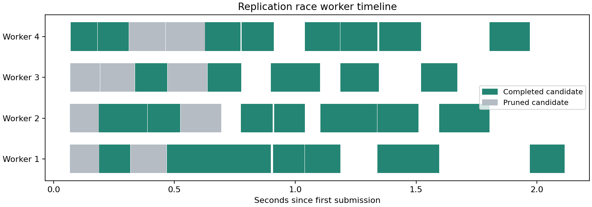

# CPU replication-allocation study — September 2026

Replication racing used **52.3% fewer evaluations** and achieved a **1.43× median
paired search speedup** against parallel full-budget search with the same four
workers. All four methods selected the same configuration within each of 20 optimizer
seeds. The independent audit outcomes therefore matched exactly.

This supports a narrow empirical claim about saved work and observed winner agreement
on a small synthetic hedging workload. It does not establish a general quality guarantee,
live trading performance, or superiority to complete external optimization frameworks.

[Reproduction commands](BENCHMARKING.md) · [Frozen protocol](evidence/cpu-2026-09-24/protocol.json) ·
[Machine-readable summary](evidence/cpu-2026-09-24/summary.json) ·
[Raw artifacts and checksums](evidence/cpu-2026-09-24/README.md)

## Workload and controls

A small NumPy network hedges a European call in a geometric Brownian motion market:
spot and strike 1, annual volatility 20%, maturity one year, zero interest/drift,
12 trading intervals, and a proportional cost rate of 0.001. Initial capital is the
same Black–Scholes call price for every candidate. Cash flows include opening,
rebalancing, and liquidation costs.

A two-layer tanh/logistic policy observes current normalized log-moneyness and time
remaining, and holds between zero and one unit of the underlying. It has no future
price inputs. The model omits previous holdings as a policy input and is deliberately
small. Each replication trains a fresh policy for 256 Adam steps with 256 fresh paths
per step, then evaluates hedging-error MSE on 2,048 fresh paths. Weight regularization
is used during training; the reported objective is unpenalized out-of-training MSE.
This is inspired by [Deep Hedging](https://arxiv.org/abs/1802.03042), not a reproduction
of the paper's full setting.

The search samples six configurations per seed: width in `{4, 8, 16}`, learning rate
log-uniform in `[0.003, 0.1]`, and regularization log-uniform in `[1e-6, 1e-3]`.
All methods receive the same pool, maximum nine replications, and paired scenario
seeds. ASHA and racing use checkpoints `(3, 9)`. Training randomness is specific to
each configuration; exogenous evaluation scenarios are shared within replication.

Twenty optimizer seeds, `0..19`, supply the independent comparison units. Method
order is randomized within seed. Serial full budget uses one worker; the other
methods use four, with one native numerical thread requested per worker. The runner
locks the best completed configuration before eight independently trained audit
replications in a disjoint seed namespace. There is no additional finalist-selection
budget. Equal locked configurations intentionally receive identical audit seeds;
the 80 campaigns are not 80 independent optimizer comparisons.

Execution used an Apple M5, 10 logical CPUs, macOS 26.4 arm64, Python 3.11.5,
NumPy 2.4.1, SciPy 1.17.0, and Matplotlib 3.10.8. Native pool control used
threadpoolctl 3.6.0; its version was verified after the run because the original
manifest omitted that field. Current manifests include it. The full
[execution manifest](evidence/cpu-2026-09-24/manifest.json) is retained unmodified.
Host load, thermal state, and CPU affinity were not controlled.

## Measured endpoints

| Method | Workers | Mean replications | Median search seconds | Mean returned objective CPU seconds | Mean audited MSE |
| --- | ---: | ---: | ---: | ---: | ---: |
| Serial full budget | 1 | 54.00 | 5.771 | 5.924 | 0.000433374 |
| Parallel full budget | 4 | 54.00 | 2.802 | 10.425 | 0.000433374 |
| ASHA | 4 | 38.40 | 2.275 | 7.052 | 0.000433374 |
| Replication race | 4 | 25.75 | 1.896 | 4.928 | 0.000433374 |

Racing's median **within-seed** speedup versus parallel full budget is **1.432×**,
with a 95% paired percentile-bootstrap interval **[1.271, 1.828]**. ASHA's descriptive
median is 1.278×, interval [1.051, 1.624]. These are medians of paired ratios, not
ratios of the table's median times. Racing saves `1 − 25.75 / 54 = 52.3%` of replications.
All 80 search/audit campaigns completed with no unmeasured attempts.

Figure: fixed-budget endpoints. Vertical bars describe nominal 95% t intervals for
mean audited quality across optimizer seeds. They are not paired-difference bounds,
sequential guarantees, or time-to-target curves.

Search wall time includes process startup, journal writes, and idle capacity.
Returned objective CPU time excludes coordinator and startup overhead. Serial and
parallel CPU totals differ even at equal replication counts; this experiment does
not identify the cause, so those totals should not be treated as interchangeable
with evaluation counts or capacity allocation.

Mean audit wall time was 0.835s (serial full), 0.948s (parallel full), 1.060s (ASHA),
and 0.884s (race); all audits execute serially and are excluded from search-speedup
claims. Allocated worker-seconds and audit CPU time are available in the summary.

## Quality inference and the reporting correction

Before the comparison, a disjoint pilot at seed 10000 produced reference audit MSE
0.00050903946. The frozen excess-MSE margin is 1% of that value:
**0.00000509039463**. The planned analysis was a one-sided 95% Student t bound on
one paired mean audit difference per optimizer seed.

Every selected configuration matched within seed, so all 20 paired differences were
exactly zero. The original implementation returned a zero-width bound and labeled
the comparisons non-inferior. Review after the run identified that this overstates
what the degenerate t approximation establishes. The corrected report returns
**`degenerate`**, with mean difference zero and **no inferential bound**.

This is a **post-run reporting correction**, not a prespecified successful
non-inferiority result. The frozen protocol, original analysis, and raw outcomes
are preserved in the evidence archive. No final runs were dropped or retuned to
obtain the corrected interpretation. Observed equality remains a useful finding;
a broader quality claim requires a harder, more varied and adequately powered study.

## Separate scaling and runtime evidence

A separate fixed workload uses 12 candidates × three replications, no pruning,
and two seeds, 20000 and 20001. Every worker setting performs identical simulation work.

| Workers | Median seconds | Median paired speedup versus one worker |
| ---: | ---: | ---: |
| 1 | 3.569 | 1.000× |
| 2 | 1.905 | 1.874× |
| 4 | 1.016 | 3.512× |
| 8 | 0.834 | 4.289× |

Only two seeds were measured, in increasing worker order within seed. This is a small
scaling demonstration, not a confidence interval across machines or a cluster result.

The timeline is the first racing campaign in the manifest (seed 0). Bars are returned
replications, colored by the candidate's final status. At most one replication is
in flight per candidate, so pruning can leave fewer active candidates than workers.
The timeline makes utilization visible but does not isolate all causes of idle gaps.

Runtime tests separately exercise real worker death, bounded retries, coordinator
termination/resume, and interruption before/during/after acceptance. Committed
observations are reused; uncommitted work can execute again with the same seeds.
Unreturned attempt CPU time remains unknown and is explicitly counted.

## Diagnostics where pruning can lose

The archived diagnostic suite contains 640 campaigns over four noise models, shared
and independent scenarios, forward/reverse candidate orders, and 20 seeds. These
cheap simulations test behavior, not useful wall-time speedup. The table below shows
one declared slice: shared scenarios, forward order, 20 seeds per method.

| Noise model | Full-budget mean pool regret | Racing mean pool regret | Racing mean replications | Runs pruning a true optimum |
| --- | ---: | ---: | ---: | ---: |
| Additive | 0 | 0 | 60.0 | 0/20 |
| Heteroscedastic | 0.005804 | 0.001954 | 101.4 | 1/20 |
| Heavy tail | 0.001954 | 0.001954 | 97.8 | 1/20 |
| Near ties | 0.027131 | 0.023467 | 197.1 | 11/20 |

Full budget uses 324 replications in every row. Pool regret uses the analytically
known best configuration in each sampled pool. Pruning an optimum and selecting a
worse winner are different events; the full-budget sample mean can also select the
wrong configuration. The near-tie result demonstrates that the racing rule has no
guaranteed protection for the optimum, even when aggregate regret looks favorable.
All other scenario/order slices remain in the
[diagnostic summary](evidence/cpu-2026-09-24/diagnostic-summary.json).

## Provenance and scope

The final financial study ran from clean revision `bef29bf`; the frozen protocol
hash is `350f440548c2f241be74e0fcddd1e9ede7fb5f9ef6831f8c6c212bfa39ab349e`.
Revision `89e75c6` corrects recovery edge cases, dependency capture, and reporting;
it generated the archived corrected report and the final diagnostic rerun. The
performance measurements therefore characterize the recorded execution revision,
not a separate timing run of the recovery fixes. Those fixes do not alter the
normal successful-path allocation rule.

The study covers one small market, six-candidate searches, short CPU replications,
and one machine. ASHA shares Aster's executor; its rung decisions are checked against
Ray 2.58.0, but Ray itself is not the measured runtime. No Optuna TPE, GPU, cluster,
stochastic-volatility, equal-wall-budget, or target-attainment comparison is claimed.
The [next research steps](../ROADMAP.md) keep those questions explicit.
