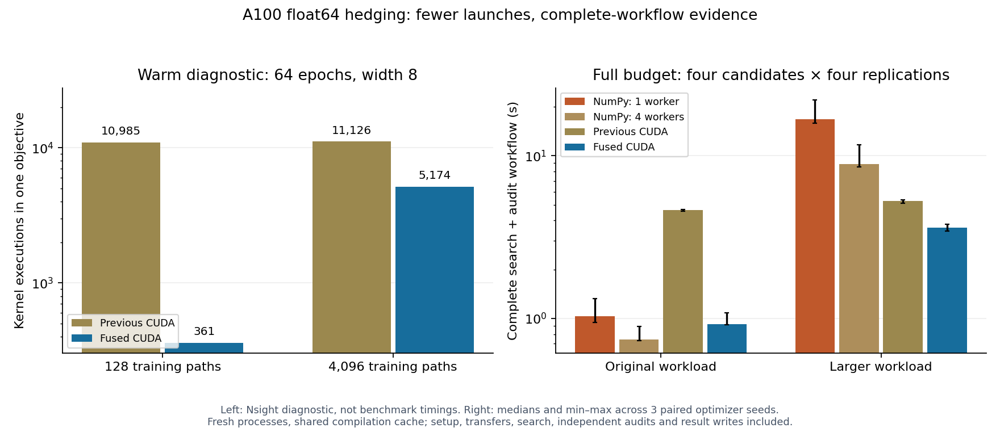

# CUDA launch fusion — A100, November 2026

The small full-budget neural-hedging search-plus-audit workflow falls from
**4.625s to 0.923s**, a **4.96× median paired improvement** over the preserved CUDA
trainer. The larger workflow falls from **5.264s to 3.604s**, a **1.46× improvement**.
These are contemporaneous comparisons from 42 fresh campaign processes.

Four CPU workers still run the small workload faster. Including interpreter
startup/exit puts small optimized CUDA roughly level with one CPU worker.
NumPy remains the default backend.



## What the profile changed

Nsight Systems identified thousands of short kernel executions in the previous
CuPy training loop. At width 8 and 64 epochs, one warmed small objective ran 10,985
kernels. It now runs **361**, a **96.7% reduction**. The larger objective runs
**5,174 instead of 11,126**, or **53.5% fewer**.

- All shapes use one kernel per epoch for finite checks, gradient norm, clipping,
  and Adam. Moments update in place; the cumulative finite flag stays on device.
- Training batches at most 512 paths with width at most 64 use four kernels per
  epoch: causal forward, chronological accounting/error, deterministic gradients/
  loss, and optimizer. Nsight records exactly 64 executions of each in the small
  diagnostic. Larger shapes retain the original CuPy/cuBLAS gradients.
- Scratch buffers belong to one training invocation and are reused through its
  epochs. The kernel cache retains no live input/output pointers. The eager
  trainer's body is unchanged from `76da272`, apart from its function name.
- Float64, initialization, shocks, transaction costs, regularization, clipping,
  Adam corrections, failure handling, and scalar-only result transfers are retained.
  Custom reductions use a fixed tree without floating-point atomics.

The fusion bounds were fixed before the workflow benchmark. Graph capture was
considered; it would require stable lifetimes for many temporary buffers and add
capture/instantiation work to first-use workflows. This change uses ordinary
kernel launches with explicit per-call ownership.

## Diagnostic profiles

All four final profiles use source **`0d2e12b`**, the same width-8 configuration and
seeds, a warmup outside capture, and one captured objective. They include training
and evaluation. These durations are under profiling and are **not benchmark
speedups**. GPU kernel duration is a sum, not utilization or host wall time.

| Workload | Implementation | Kernel executions | Summed GPU kernel ms | Profiled objective ms |
| --- | --- | ---: | ---: | ---: |
| Small | Eager | 10,985 | 37.735 | 275.319 |
| Small | Optimized | 361 | 4.045 | 11.502 |
| Larger | Eager | 11,126 | 76.428 | 282.584 |
| Larger | Optimized | 5,174 | 81.611 | 201.900 |

The larger diagnostic's summed GPU kernel duration increases about 6.8%, despite
fewer launches and lower host duration. The complete unprofiled benchmark below
establishes the measured workflow improvement; the profile does not establish
that all GPU arithmetic became faster. Clocks and host contention are uncontrolled.
Nsight's API percentages summarize captured API time, not application wall time;
see [NVIDIA's analysis guide](https://docs.nvidia.com/nsight-systems/AnalysisGuide/).

## Frozen complete-workflow protocol

Reuse the prior market and caps: 12 trading intervals, 64 epochs, four sampled
candidates, FullBudget(4) or ReplicationRace((2,4)), and three independent audits
per locked winner. Original workload: 128 training paths / 2,048 evaluation paths.
Larger workload: 4,096 / 32,768. Three optimizer seeds: 31000, 31001, 31002.

For each workload and seed, run NumPy/one worker, optimized CUDA/one worker and
eager CUDA/one worker with both schedulers, plus NumPy/four workers with full
budget. All 42 job requests, their order, settings and source hashes are frozen
before campaign timing. Every CPU worker uses one BLAS thread; audits use one
worker. Campaigns run sequentially on the same A100 PCIe 40GB host.

Versions: Python 3.12.3, NumPy 2.5.4, CuPy 14.2.0, CUDA 13.2.86, driver 615.71.10,
Nsight Systems 2026.1.1.0, Ubuntu 24.04. Source snapshots have no `.git` directory;
manifest Git metadata is null. All **37 source hashes** independently match commit
`0d2e12b`; this is how executed provenance is established.

## Unprofiled workflow results

| Workload / scheduler | NumPy, 1 worker (s) | NumPy, 4 workers (s) | Eager CUDA (s) | Optimized CUDA (s) | Paired improvement vs eager |
| --- | ---: | ---: | ---: | ---: | ---: |
| Small / full budget | 1.032 | 0.742 | 4.625 | 0.923 | **4.955×** |
| Larger / full budget | 16.720 | 8.865 | 5.264 | 3.604 | **1.461×** |
| Small / race | 0.864 | — | 3.713 | 0.955 | **3.881×** |
| Larger / race | 12.351 | — | 4.413 | 2.983 | **1.423×** |

Times are medians across optimizer seeds; speedups are paired within seed first.
Ratios of displayed medians can differ. The figure's whiskers show min–max across
three seeds, not confidence intervals. Small full-budget improvement over eager
ranges **4.33–5.06×**; larger improvement ranges **1.41–1.48×**.

Optimized larger full-budget workflows are **4.64×** faster than one NumPy worker
and **2.57×** faster than four, by paired medians. Small workflow speedup versus
one worker is 1.13×, but versus four workers it is 0.81×.

The workflow clock includes backend/context and numerical imports, allocation,
host RNG, transfers, simulation, training, evaluation, search scheduling, SQLite
journals, winner locking, independent audits and result writes. Timing-file
publication is outside that clock. The parent also measures interpreter startup,
imports, trailer and exit:

| Full-budget process median | NumPy, 1 worker | NumPy, 4 workers | Eager CUDA | Optimized CUDA |
| --- | ---: | ---: | ---: | ---: |
| Small | 1.124s | 0.846s | 4.929s | 1.165s |
| Larger | 16.809s | 8.970s | 5.534s | 3.874s |

Paired process improvements over eager are **4.18× / 1.43×** for small/larger.
Small process speedup versus one CPU worker is **0.977×**, with range 0.896–1.027×;
this does not establish an end-to-end CUDA advantage over one CPU worker. Four CPU workers remain
faster there. Larger process speedups versus one/four CPU workers are **4.34× /
2.41×**. These scopes must remain distinct when describing latency.

No objective warmup precedes a campaign. Fresh processes inherit the ordinary
shared compiler cache, which correctness checks and diagnostic profiles populate.
Compilation/module loading that occurs is inside the workflow clock; this is not
an empty-cache installation benchmark. Three seeds on one host are descriptive
engineering evidence, not p99 or broad hardware/financial quality guarantees.

## Quality, failures and verification

All seven matched financial metrics pass `rtol=1e-6, atol=1e-8` for the fixed-budget
CPU controls and both eager/optimized schedulers. Winner agreement and independent
audit differences are recorded explicitly. Racing identity/allocation differences
are allowed and reported; different valid winners retain their own audits rather
than being treated as malformed evidence. Fixed-budget search metric completeness
remains mandatory.

Across all campaigns: **594 accepted search observations + 126 audits**, with zero
objective failures and zero unsuccessful attempts. Numerical checks include finite
inputs/outputs, matching random inputs, gradients/finite differences, clipping,
finite-gradient norm overflow, zero costs/regularization, 1/8/64-epoch training,
dispatch boundaries, changed inputs, nondefault streams, spawned execution and
resume. Local suite: **257 passed**, 40 GPU cases skipped. A100 host: **127 passed**,
two CPU-only dependency checks skipped.

Compute Sanitizer checked 42 tests with **zero errors and zero leaked bytes**;
one CPU-only test skipped and two study tests were deselected. It uses the previously
documented `--report-api-errors explicit` mode and test-pool cleanup. All three GPU
training source files in that run match `0d2e12b`. See `memcheck.log` and the
[earlier reporting-mode investigation](../cuda-workflow-2026-11-04/README.md).
An initial NVRTC host-header dependency was corrected before these checks and all
performance measurements; that failed validation log is retained.

An independent code review identified two collector issues: CPU controls lacked
all-metric gates, and different audit winners could incorrectly invalidate a
comparison. Both were fixed after failing regressions; the complete suite passed.
The independent data audit checked 1,017 finite JSON files, 84 journals and all
720 metric files. Every reported winner/allocation pair agrees; maximum audit-mean
MSE difference is 1.63e-19. Exact summary regeneration and independent paired-ratio
checks pass. Details are recorded in `validation.json`.

## Reproduce and inspect

From the executed source on the CUDA development host:

```bash
python -m pip install -e '.[dev,benchmark,cuda13]'
python -m pytest tests/test_hedging.py tests/test_study.py \
  tests/test_hedging_cuda.py tests/test_cuda_fused.py tests/test_cuda_workflow.py -q
compute-sanitizer --tool memcheck --report-api-errors explicit \
  --error-exitcode 99 --leak-check full python -m pytest \
  tests/test_hedging_cuda.py tests/test_cuda_fused.py \
  -k 'not real_spawned and not frozen_study' -q
python -m benchmarks.cuda_workflow run --include-eager --output results/launch-new
```

Use fresh output paths. To repeat the diagnostics, extract `profile_objective.py`
from the raw archive, set `PYTHONPATH=src:.`, and run each backend (`cuda_eager`,
`cuda`) and training size (`128`, `4096`):

```bash
nsys profile --trace=cuda,nvtx --sample=none --cpuctxsw=none \
  --capture-range=cudaProfilerApi --capture-range-end=stop --output /tmp/trace-new \
  python profile_objective.py --backend cuda --batch-paths 128 --output /tmp/probe-new.json
nsys stats --report cuda_api_sum,cuda_gpu_kern_sum,cuda_gpu_trace,cuda_api_trace \
  --format csv --output /tmp/export-new /tmp/trace-new.nsys-rep
```

`raw-records.tar.gz` preserves campaign logs, metrics, journals, requests, validation
reports and the exact diagnostic script. Profiler exports include every CUDA kernel/
memory operation and API trace row plus aggregate CSVs. These reproduce all four
kernel counts and summed durations exactly. Opaque Nsight reports/databases include
environment metadata and remain private locally; published exports omit it.
`records.json`, `summary.json` and `profiles-summary.json` provide direct access.
Run `python docs/evidence/cuda-launch-2026-11-04/plot.py` to regenerate the figure.
`SHA256SUMS` verifies artifacts. See the [usage guide](../../CUDA_WORKFLOW.md),
[design](../../superpowers/specs/2026-11-04-cuda-launch-design.md), and
[plan](../../superpowers/plans/2026-11-04-cuda-launch.md).
