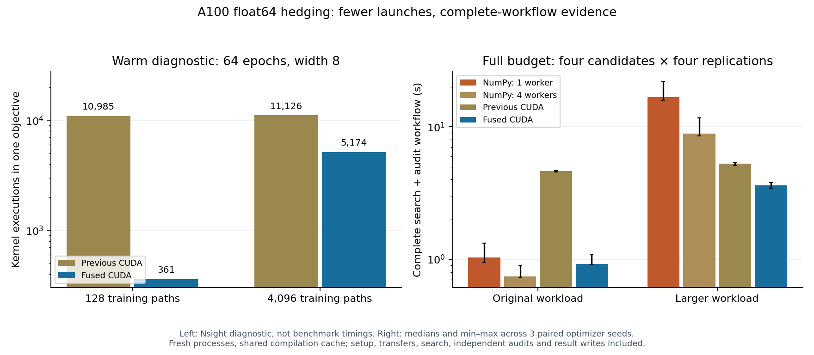

# CUDA launch fusion — A100, November 2026

Combining CUDA kernels cut the median time for the small fixed-budget hedging
search and its audit from **4.625 s to 0.923 s**. On the larger workload, the
time fell from **5.264 s to 3.604 s**. Across matching seeds, the median speedups
over the original CUDA trainer were **4.96×** and **1.46×**. The study ran 42
searches, each in a fresh process on the same host.

Four CPU workers finished the small workload fastest. When timing included
Python startup and exit, one CPU worker and the optimized GPU trainer took
about the same time. NumPy remains the default backend.



## What the profile changed

Nsight Systems showed thousands of short kernel calls in the original CuPy
training loop. After warmup, a single training and evaluation run with width 8
and 64 epochs made 10,985 kernel calls on the small workload. Combining kernels
cut that count to **361**, a **96.7% reduction**. On the larger workload, calls
fell from 11,126 to **5,174**, or **53.5% fewer**.

- For every batch size, one kernel checks for nonfinite values, computes the
  gradient norm, clips gradients, and applies the Adam update. It updates the
  moments in place and keeps a running flag for nonfinite values on the GPU.
- Batches with up to 512 paths and a model width of up to 64 use four kernels
  per epoch. They run the forward pass using prices available at each step,
  calculate trading costs and hedging error in time order, compute gradients
  and loss in a fixed order, and update the model. Nsight recorded 64 calls to
  each kernel in the small run. Larger batches or wider models still use
  CuPy/cuBLAS for gradients.
- Scratch buffers belong to one training invocation and are reused through its
  epochs. The kernel cache retains no live input/output pointers. The eager
  trainer's body is unchanged from `76da272`, apart from its function name.
- Float64, initialization, shocks, transaction costs, regularization, clipping,
  Adam corrections, failure handling, and scalar-only result transfers are retained.
  Custom reductions use a fixed tree without floating-point atomics.

The batch-size and width limits were set before timing. CUDA graph capture
would require many temporary buffers to stay at fixed addresses and would add
setup time on the first call. The trainer uses ordinary kernel launches and
allocates its own scratch buffers for each call.

## Diagnostic profiles

All four profiles used commit **`0d2e12b`** and the same width-8 configuration
and seeds. After warmup, Nsight timed one training and evaluation run. The GPU
column adds up time spent in individual kernels. The last column gives elapsed
time on the host with profiling enabled.

| Workload | Implementation | Kernel executions | Summed GPU kernel ms | Profiled objective ms |
| --- | --- | ---: | ---: | ---: |
| Small | Eager | 10,985 | 37.735 | 275.319 |
| Small | Optimized | 361 | 4.045 | 11.502 |
| Larger | Eager | 11,126 | 76.428 | 282.584 |
| Larger | Optimized | 5,174 | 81.611 | 201.900 |

On the larger workload, the kernels spent about 6.8% more time on the GPU in
total, even as the number of launches and the elapsed time on the host fell.
The timings below come from running the complete search with the profiler off.
Clock speeds and competing work on the host could vary. Nsight expresses API
percentages as a share of time spent in captured API calls. [NVIDIA's analysis guide](https://docs.nvidia.com/nsight-systems/AnalysisGuide/)

## Frozen complete-workflow protocol

The study kept the market and search limits from the earlier benchmark. Each
search used 12 trading intervals, 64 epochs, four sampled candidates, and either
`FullBudget(4)` or `ReplicationRace((2, 4))`. Each winner had three independent
audits. The small workload used 128 training paths per batch and 2,048 evaluation
paths. The larger one used 4,096 and 32,768. The optimizer seeds were 31000,
31001, and 31002.

For each workload and seed, both schedulers ran with one worker on each
backend (NumPy, eager CUDA, and optimized CUDA). Four NumPy workers also ran
the fixed-budget search. The study recorded all 42 jobs, their order, settings,
and source hashes before timing began. Each CPU worker used one BLAS thread.
All audits used one worker. The jobs ran one at a time on the same host with
an A100 PCIe 40 GB.

The host ran Ubuntu 24.04, Python 3.12.3, NumPy 2.5.4, CuPy 14.2.0, CUDA
13.2.86, driver 615.71.10, and Nsight Systems 2026.1.1.0. The source snapshot
omitted the `.git` directory, so the manifest's Git fields are null. All **37
source hashes** match commit `0d2e12b`.

## Unprofiled workflow results

| Workload / scheduler | NumPy, 1 worker (s) | NumPy, 4 workers (s) | Eager CUDA (s) | Optimized CUDA (s) | Paired improvement vs eager |
| --- | ---: | ---: | ---: | ---: | ---: |
| Small / full budget | 1.032 | 0.742 | 4.625 | 0.923 | **4.955×** |
| Larger / full budget | 16.720 | 8.865 | 5.264 | 3.604 | **1.461×** |
| Small / race | 0.864 | — | 3.713 | 0.955 | **3.881×** |
| Larger / race | 12.351 | — | 4.413 | 2.983 | **1.423×** |

Each time is the median across three optimizer seeds. For speedups, the
calculation divides the times for each seed first and then takes the median,
so the result can differ from the ratio of the times shown. The figure's
whiskers span the lowest and highest observations. For the fixed-budget search,
speedups over eager CUDA ranged from **4.33–5.06×** on the small workload and
**1.41–1.48×** on the larger one.

Optimized larger full-budget workflows are **4.64×** faster than one NumPy worker
and **2.57×** faster than four, by paired medians. Small workflow speedup versus
one worker is 1.13×, but versus four workers it is 0.81×.

Workflow time starts before the numerical imports and backend setup. It includes
allocation, random number generation on the CPU, transfers, simulation, training,
evaluation, scheduling, SQLite writes, winner selection, independent audits, and
saving results. The parent process also times interpreter startup, imports, the
final timing-file write, and interpreter exit.

| Full-budget process median | NumPy, 1 worker | NumPy, 4 workers | Eager CUDA | Optimized CUDA |
| --- | ---: | ---: | ---: | ---: |
| Small | 1.124s | 0.846s | 4.929s | 1.165s |
| Larger | 16.809s | 8.970s | 5.534s | 3.874s |

Including startup and exit, optimized CUDA was **4.18×** faster than eager CUDA
on the small workload and **1.43×** faster on the larger one. Against one CPU
worker, the small workload had a median speedup of **0.977×**. The range across
seeds (0.896–1.027×) included runs where the CPU won and runs where CUDA won.
Four CPU workers finished the small workload fastest. On the larger workload,
CUDA was **4.34×** faster than one CPU worker and **2.41×** faster than four.

Each search started in a fresh process without a warmup. Correctness checks
and profiling had already populated the shared compiler cache. The timer
included any further compilation and module loading. The three seeds on this
host give no estimate of 99th-percentile latency, performance on other GPUs,
or hedging quality in other markets.

## Quality, failures and verification

All seven matched financial metrics agreed within `rtol=1e-6, atol=1e-8` for
the fixed-budget CPU comparisons and for eager versus optimized CUDA under
both schedulers. The records show which candidates won, how many runs each
received, and how far the independent audits differed. The checks allow racing
searches to stop different candidates and report the audit for each winner.
Fixed-budget searches must report every metric.

The study recorded **594 accepted search observations and 126 audits**.
Every attempt succeeded and every objective returned a result. Numerical checks include finite
inputs/outputs, matching random inputs, gradients/finite differences, clipping,
finite-gradient norm overflow, zero costs/regularization, 1/8/64-epoch training,
dispatch boundaries, changed inputs, nondefault streams, spawned execution and
resume. Locally, **257 tests passed** and 40 GPU cases were skipped. On the
A100 host, **127 tests passed** and two CPU-only dependency checks were skipped.

Compute Sanitizer checked 42 tests and reported **zero errors and zero leaked
bytes**. One CPU-only test was skipped and two study tests were deselected.
The run used `--report-api-errors explicit`, and the tests released their
memory pools at teardown. All three GPU training source files match `0d2e12b`.
An earlier run failed because NVRTC needed a host header. The archive includes
that log. All checks and timing runs reported here used the corrected source.
See `memcheck.log` and the [earlier reporting-mode investigation](../cuda-workflow-2026-11-04/README.md).

An independent review found two errors in the results collector. It skipped
some financial metrics in the CPU comparison and could reject valid runs when
the searches selected different winners. Regression tests reproduced both
errors, and the full suite passed after the fixes. An independent check covered
1,017 JSON files with finite values, 84 journals, and all 720 metric files.
All reported pairs agreed on the winner and the number of runs per candidate.
The largest difference in mean squared hedging error across paired audit means
was 1.63e-19. The saved records reproduced the summary exactly, and a separate
calculation confirmed the paired speedups. See `validation.json` for the checks.

## Reproduce and inspect

Run these commands from the recorded source on the CUDA development host.

```bash
python -m pip install -e '.[dev,benchmark,cuda13]'
python -m pytest tests/test_hedging.py tests/test_study.py \
  tests/test_hedging_cuda.py tests/test_cuda_fused.py tests/test_cuda_workflow.py -q
compute-sanitizer --tool memcheck --report-api-errors explicit \
  --error-exitcode 99 --leak-check full python -m pytest \
  tests/test_hedging_cuda.py tests/test_cuda_fused.py \
  -k 'not real_spawned and not frozen_study' -q
python -m benchmarks.cuda_workflow run --include-eager --output results/launch-new
```

Use fresh output paths. To repeat the diagnostics, extract `profile_objective.py`
from the raw archive, set `PYTHONPATH=src:.`, and run each combination of
backend (`cuda_eager`, `cuda`) and training size (`128`, `4096`).

```bash
nsys profile --trace=cuda,nvtx --sample=none --cpuctxsw=none \
  --capture-range=cudaProfilerApi --capture-range-end=stop --output /tmp/trace-new \
  python profile_objective.py --backend cuda --batch-paths 128 --output /tmp/probe-new.json
nsys stats --report cuda_api_sum,cuda_gpu_kern_sum,cuda_gpu_trace,cuda_api_trace \
  --format csv --output /tmp/export-new /tmp/trace-new.nsys-rep
```

`raw-records.tar.gz` contains the run logs, metrics, journals, job requests,
validation reports, and profiling script. The exported traces list every CUDA
kernel, memory operation, and API call, with totals in separate CSV files.
These files reproduce the kernel counts and summed durations in all four
profiles. The original Nsight reports and databases are stored locally because
they contain private details about the host. The published exports omit those
details. For individual timings and comparisons, see `records.json`,
`summary.json`, and `profiles-summary.json`.
Run `python docs/evidence/cuda-launch-2026-11-04/plot.py` to regenerate the figure.
`SHA256SUMS` lists the file checksums. See the [usage guide](../../CUDA_WORKFLOW.md),
[design](../../superpowers/specs/2026-11-04-cuda-launch-design.md), and
[plan](../../superpowers/plans/2026-11-04-cuda-launch.md).
