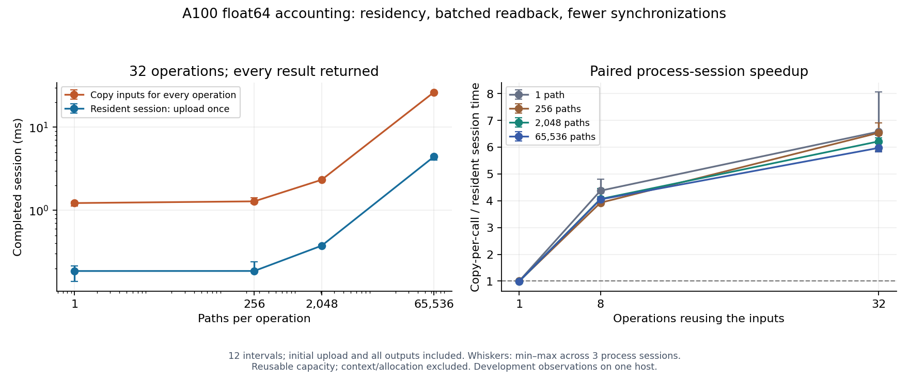

# Resident CUDA accounting sessions — November 2026

Uploading 65,536 price paths and their holdings once cut the time for 32
accounting calculations on the A100 PCIe 40 GB from **26.41 ms to 4.42 ms**.
Across three fresh processes, the speedup ranged from **5.82× to 6.44×**, with
a median of **5.97×**.

Both methods run the same float64 kernel once per transaction-cost rate. For
each rate, both return profit and loss, cost, and turnover for every path. The
resident version keeps the prices and holdings on the GPU between calls,
copies results back in batches, and synchronizes less often. Its timing includes
the first upload, every kernel, all downloads, and synchronization. Both methods
set up the GPU context and allocate reusable host and device memory before timing.

The benchmark times the accounting step across different transaction-cost
rates for fixed prices and holdings. The CPU reference computes each rate
separately and could reuse more work across rates.



## Protocol and results

The benchmark used commit `6cb9805`, CUDA 13.2.86, driver 615.71.10,
GCC 13.3.0, and Ubuntu 24.04. The kernel used 128 threads per block and
float64 arithmetic with fast math and fused multiply-add contraction disabled.
Each workload used 12 intervals and seed 1729. The number of transaction-cost
rates is K. Rates span `[0,0.01]` when K is greater than one. The single-rate
run uses 0.01.

Each combination of four path counts and three operation counts ran in three
fresh processes, giving **36 process runs and 540 sample sets**. Each process
ran five warmups and 15 timed samples. Each sample timed four methods in a
reproducibly shuffled order. The benchmark interleaved settings and ran one GPU
process at a time. Clock speeds, temperatures, CPU placement, and competing work
could vary. GPU process snapshots covered only the start and end of a run. The
three processes per setting on this host give a range of observed speedups. The
99th-percentile runtime and performance on other hardware remain unmeasured.

| Paths | Operations | Copy-per-call (ms) | Resident session (ms) | Median paired speedup |
| ---: | ---: | ---: | ---: | ---: |
| 1 | 32 | 1.2218 | 0.1857 | 6.58× |
| 256 | 32 | 1.2811 | 0.1859 | 6.54× |
| 2,048 | 32 | 2.3289 | 0.3747 | 6.22× |
| 65,536 | 32 | 26.4086 | 4.4219 | 5.97× |

For each setting, the table shows the median of the three process medians.
Speedups were calculated within each process before taking their median, so
they can differ from the ratio of the two times shown. The figure's whiskers
span the lowest and highest observed values across processes. The full table
for all 12 settings is in `summary.json`. Reusing inputs for eight rates gave
roughly a 4× speedup. With one rate, both methods uploaded the inputs once and
the resident version took about the same time or slightly longer.

At 65,536 paths and 32 rates, input copies fell from **400 MiB in 64 calls** to
**12.5 MiB in two calls**. Both methods copied **48 MiB** of results back to
the host. The baseline needed 96 copies and the resident version needed three.
These counts come from explicit CUDA copy requests. Physical PCIe traffic and
implicit kernel arguments were outside the measurement. Starting the clock
after the input upload gave a separate median of **3.4124 ms**. The
**4.4219 ms** in the table includes that upload.

## Correctness and records

- Default correctness and required memcheck pass **117 cases**, including 19 new
  resident lifecycle/reload/shape/numerical cases.
- Default and explicit pipeline Compute Sanitizer runs report **zero errors and
  zero leaked bytes**. The K=256 boundary also passes.
- Every measured operation's three arrays are compared against the CPU reference;
  all four methods' ordered output hashes agree in these records.
- All 36 records passed checks on the number of comparisons
  (`12 * paths * operations * repeats`), the transfer counts, whether every
  output was returned, finite timings, and hashes. Commit `3f2da2b` tightened
  the check on the comparison count after the run.
- The source files match `6cb9805`, and the executable matches its recorded
  hash. Reading the original measurements in the order listed in the manifest
  reproduced the summary exactly.

`raw-records.tar.gz` contains the build logs and settings, source and binary
hashes, correctness and sanitizer reports, boundary and smoke tests, machine
inventory, and individual process records. The manifest, summary, and validation
reports are also available as JSON files in this directory. `SHA256SUMS` lists
the file checksums.

## Reproduce

From the recorded source on a compatible CUDA development host:

```bash
bash cuda/run_tests.sh --output-dir /tmp/aster-resident-validation --sanitizer required
compute-sanitizer --tool memcheck --error-exitcode 99 --leak-check full \
  /tmp/aster-resident-validation/build/aster_cuda --mode pipeline \
  --paths 129 --intervals 13 --operations 4 --warmups 1 --repeats 2 \
  --output /tmp/aster-resident-pipeline-memcheck.json
python3 cuda/benchmark_pipeline.py \
  --binary /tmp/aster-resident-validation/build/aster_cuda \
  --output /tmp/aster-resident-benchmark --source-revision 6cb9805 \
  --paths 1 256 2048 65536 --operations 1 8 32 --sessions 3 \
  --repeats 15 --warmups 5 --intervals 12 --block-size 128 --seed 1729
```

Choose fresh output paths. Regenerate the figure with
`python docs/evidence/cuda-resident-2026-11-04/plot.py` and the benchmark plotting
dependencies installed. See the [design](../../superpowers/specs/2026-11-04-resident-cuda-design.md)
and [CUDA guide](../../../cuda/README.md) for details on reusing buffers and
reading the output arrays.
