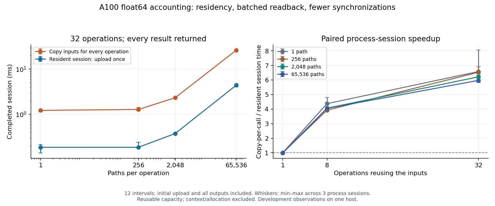

# Resident CUDA accounting sessions — November 2026

On the A100 PCIe 40GB, a 65,536-path, 32-operation accounting session fell from
**26.41ms to 4.42ms**. Median paired process speedup was **5.97×**, with a
**5.82–6.44×** range across three process sessions.

Both methods run the same float64 kernel K times on identical prices/holdings,
using K different transaction-cost rates. Both return **all K operations' P&L,
cost, and turnover arrays**. The main resident timing includes initial upload,
every kernel, all output downloads, and synchronization. GPU context and reusable
host/device capacity are prepared before timing.

This is a controlled accounting sensitivity workload, not GPU neural training or
complete HPO. CPU context measurements do not use an optimally cached sensitivity
algorithm. Gains combine input residency, bulk result copies, and fewer
synchronizations; the arithmetic is unchanged.



## Protocol and results

Executed source `6cb9805`; CUDA 13.2.86, driver 615.71.10, GCC 13.3.0, Ubuntu 24.04,
block size 128, float64, no fast-math/FMA contraction. Workloads use 12 intervals,
seed 1729, and rates spanning `[0,0.01]` (K=1 uses 0.01).

Four path counts × three operation counts × three fresh processes produce **36
process runs and 540 sample sets**. Every process has five warmups and 15 samples;
each sample times four methods in reproducibly shuffled order. Settings are
interleaved and GPU processes sequential. Clocks, thermals, affinity, and host
contention are uncontrolled. Empty GPU process snapshots do not prove continuous
exclusive use. Three processes on one host do not establish p99 or general speedup.

| Paths | Operations | Copy-per-call (ms) | Resident session (ms) | Median paired speedup |
| ---: | ---: | ---: | ---: | ---: |
| 1 | 32 | 1.2218 | 0.1857 | 6.58× |
| 256 | 32 | 1.2811 | 0.1859 | 6.54× |
| 2,048 | 32 | 2.3289 | 0.3747 | 6.22× |
| 65,536 | 32 | 26.4086 | 4.4219 | 5.97× |

Times are medians of process medians. Speedups are calculated within each process
first; dividing displayed times can differ from the paired summary. Whiskers in
the figure show descriptive min–max across processes, not confidence intervals.
The full 12-setting table is in `summary.json`. K=8 gives roughly 4× speedup;
K=1 is approximately unchanged or slightly slower, with no input reuse to exploit.

At 65,536 paths/K32, requested input copies fall from **400 MiB / 64 calls** to
**12.5 MiB / 2 calls**. Both return **48 MiB** of outputs: 96 copies for the baseline,
3 for the resident session. Counters describe CUDA copy requests, not measured
physical PCIe traffic or implicit kernel arguments. The **3.4124ms** preloaded
median additionally excludes input upload and is not the primary 4.4219ms result.

## Correctness and records

- Default correctness and required memcheck pass **117 cases**, including 19 new
  resident lifecycle/reload/shape/numerical cases.
- Default and explicit pipeline Compute Sanitizer runs report **zero errors and
  zero leaked bytes**. The K=256 boundary also passes.
- Every measured operation's three arrays are compared against the CPU reference;
  all four methods' ordered output hashes agree in these records.
- All 36 records pass the strengthened validator's exact integer comparison count
  `12 * paths * operations * repeats`, transfer counts, all-output flags, finite
  times, and hashes. Hardening at `3f2da2b` changes no GPU or timing code.
- Sources match `6cb9805`, the binary hash matches its recorded identity, and the
  summary regenerates exactly using manifest job order. No measurements were edited.

`raw-records.tar.gz` contains build logs/metadata, source/binary hashes, correctness/sanitizer
reports, boundary/smoke checks, inventory, and all raw process records. The manifest,
summary, and validation JSON files provide compact access. `SHA256SUMS` verifies
artifacts.

## Reproduce

From the recorded source on a compatible CUDA development host:

```bash
bash cuda/run_tests.sh --output-dir /tmp/aster-resident-validation --sanitizer required
compute-sanitizer --tool memcheck --error-exitcode 99 --leak-check full \
  /tmp/aster-resident-validation/build/aster_cuda --mode pipeline \
  --paths 129 --intervals 13 --operations 4 --warmups 1 --repeats 2 \
  --output /tmp/aster-resident-pipeline-memcheck.json
python3 cuda/benchmark_pipeline.py \
  --binary /tmp/aster-resident-validation/build/aster_cuda \
  --output /tmp/aster-resident-benchmark --source-revision 6cb9805 \
  --paths 1 256 2048 65536 --operations 1 8 32 --sessions 3 \
  --repeats 15 --warmups 5 --intervals 12 --block-size 128 --seed 1729
```

Choose fresh output paths. Regenerate the figure with
`python docs/evidence/cuda-resident-2026-11-04/plot.py` and the benchmark plotting
dependencies installed. See the [design](../../superpowers/specs/2026-11-04-resident-cuda-design.md)
and [CUDA guide](../../../cuda/README.md) for the state/output contract.
