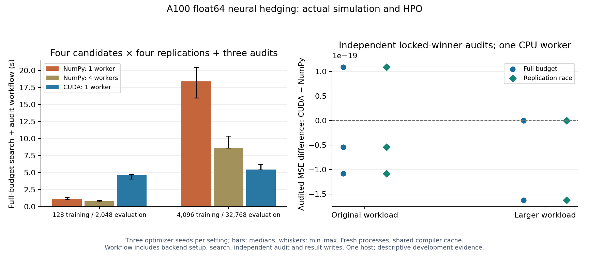

# CUDA simulation and HPO — A100, November 2026

On the larger workload, a fixed-budget hedging search and its audit took
**5.44 s on CUDA**, **18.41 s with one NumPy worker**, and **8.65 s with four**.
Across matching seeds, the median CUDA speedup was **3.38×** over one CPU
worker and **1.58×** over four. NumPy was faster on the original small
workload and remains the default.

The benchmark runs the full search in float64. It simulates prices, runs the
model forward and backward, clips gradients, applies Adam updates, accounts
for trading costs, and evaluates the hedge. `Study` schedules each run and
records it in SQLite. After the search
selects a winner, the audit evaluates it on fresh simulations. The earlier
accounting benchmark measured only the cost of calculating results for fixed
inputs.



## Frozen protocol

All 35 source files listed in the manifest match commit **`f7d5669`**.
The study ran the 30 searches in the order listed in the manifest, each in a
fresh process with a distinct process ID. The table lists the settings chosen
before timing began.

| Setting | Original workload | Larger workload |
| --- | ---: | ---: |
| Training paths per epoch | 128 | 4,096 |
| Evaluation paths | 2,048 | 32,768 |
| Epochs / trading intervals | 64 / 12 | 64 / 12 |
| Optimizer seeds | 31000, 31001, 31002 | same |
| Candidates per search | 4 | 4 |
| Full-budget replications per candidate | 4 | 4 |
| Racing checkpoints | 2, 4 | 2, 4 |
| Independent audits per winner | 3 | 3 |

The sampler varies model width, learning rate, and regularization. For each
workload and seed, one NumPy worker and one CUDA worker each ran a fixed-budget
search and a racing search. Four NumPy workers also ran the fixed-budget search.
Each CPU worker used one BLAS thread. All audits used one worker. The GPU
searches ran one at a time. Snapshots taken before and after showed no other
GPU processes. Activity during each search was unmonitored.

The host ran Ubuntu 24.04 with an A100 PCIe 40 GB (compute capability 8.0),
driver 615.71.10, CUDA 13.2.86, CuPy 14.2.0, NumPy 2.5.4, and Python 3.12.3.
The archive lists the CPU, compiler, libraries, environment, and device settings.

## Complete workflow results

Times are medians across the three optimizer seeds. Speedup is the median of
the CPU time divided by the GPU time for each seed. It can differ from the
ratio of the two times shown in the table.

| Workload / scheduler | NumPy, 1 worker (s) | NumPy, 4 workers (s) | CUDA (s) | Paired speedup vs 1 worker | vs 4 workers |
| --- | ---: | ---: | ---: | ---: | ---: |
| Original / full budget | 1.155 | 0.816 | 4.616 | 0.283× | 0.172× |
| Larger / full budget | 18.414 | 8.646 | 5.443 | **3.383×** | **1.584×** |
| Original / race | 0.945 | — | 3.885 | 0.242× | — |
| Larger / race | 13.581 | — | 4.487 | **3.480×** | — |

For the larger fixed-budget search, CUDA speedups ranged from **2.57–3.78×**
over one CPU worker and **1.39–1.92×** over four. The figure's whiskers span the
lowest and highest values observed across the three seeds. On the original
fixed-budget workload, CUDA took about 3.5 times as long as one NumPy worker by
the median paired comparison. At that size the GPU did too little work per
operation to recover its setup and execution overhead.

The workflow timer starts before numerical imports and backend setup and stops
when computation finishes and the results have been written. It covers random
number generation on the CPU, transfers, simulation, training, evaluation,
scheduling, SQLite writes, winner selection, and audits. The parent process
also times Python startup and exit, including the final timing-file write.
On the larger fixed-budget workload, median process times were **18.504 s**
with one NumPy worker, **8.749 s** with four, and **5.728 s** on CUDA. Using
that clock, CUDA speedups across matching seeds were **3.230×** and **1.522×**.

Each search started in a new process without a warmup and used the shared CuPy
disk cache that earlier correctness checks had helped populate. Timing included
CUDA context setup and module loading. Clock speeds, temperatures, CPU placement,
and competing work on the host could vary. The study measured three seeds on
one host. The 99th-percentile runtime, further CPU tuning, and hedging quality
in other markets remain untested.

## Work and quality checks

- Each fixed-budget search completed 16 evaluations and three audits. Across
  all searches and audits there were **428 search observations and 90 audit
  observations**. Every objective and every attempt succeeded.
- The one-worker NumPy and CUDA searches picked the same settings in all 12
  comparisons. The six fixed-budget searches with four NumPy workers picked
  the same winners as well. Both backends completed the same number of racing
  evaluations for each seed, with counts of `12, 12, 10` for the larger
  workload and `14, 10, 12` for the original.
- Every matched loss and all seven financial metrics agreed within
  `rtol=1e-6, atol=1e-8`. The largest difference in mean squared hedging error
  (MSE) was **2.17e-18**. Across all metrics, the largest difference was
  **8.88e-16**, in mean turnover.
- The audits used separate training and price-path seeds from the search.
  Audit MSEs ranged from about `4.2e-4` to `5.6e-4` in this synthetic market.
  Comparing the same winners, the largest absolute difference in audit mean
  MSE between backends was **1.63e-19**.
- Each evaluation uploads the initial NumPy parameters and random shocks once.
  Price simulation, model parameters, positions, accounting, gradients, and
  Adam updates then stay on the GPU. The timer includes random number generation
  on the CPU. The shared accounting kernel uses float64 and the original
  transaction-cost rules.

An independent check covered 731 JSON files with finite values, 60 SQLite
journals, 518 metric files, every process ID, the run order, and the source
hashes. The original records reproduced the summary exactly. With three
optimizer seeds and three audits per winner, the study could check agreement
on these runs. Testing whether any loss in hedging quality stays within an
acceptable margin would require a larger study. The racing results include
their actual run counts because the scheduler can stop candidates early.

## Correctness and memory checks

- Local combined regression suite: **211 passed**, 18 GPU tests skipped on the CPU
  development host. On the A100 host: **59 integration tests passed**, two CPU-only
  optional-dependency checks skipped. Tests include full analytic/finite-difference
  gradients, 1/8/64-epoch parameter and metric agreement, stream handling, partial
  blocks, invalid arrays, no look-ahead, spawned search, and frozen-study resume.
- Rebuilt standalone executable: **117 correctness cases**, default Compute Sanitizer
  memcheck with **zero errors and zero leaked bytes**.
- Final integrated accounting/gradient/training memcheck: **14 tests passed**, zero
  errors and zero leaked bytes, using `--report-api-errors explicit` and releasing
  CuPy test pools before context teardown. See `final-workflow-memcheck.log`.

The initial default extended API mode reported cuBLASLt internal kernel lookups
and retained CuPy pool allocations at test teardown. A library-only control with
no project imports reproduced 48 lookup reports; releasing pools removed the
allocation reports. With explicit API reporting that control and the integrated
checks pass. This mode retains memory instrumentation and returned API errors
while excluding extended internal logging, as described in
[NVIDIA's reporting-mode documentation](https://docs.nvidia.com/compute-sanitizer/ComputeSanitizer/index.html).
The original reports, both controls, and their source are preserved in the raw
archive; the default extended integrated run is not reported as a pass.

## Reproduce and inspect

Run these commands from the recorded source on a compatible CUDA development host.

```bash
python -m pip install -e '.[dev,benchmark,cuda13]'
python -m pytest tests/test_hedging.py tests/test_hedging_cuda.py \
  tests/test_study.py tests/test_cuda_workflow.py -q
compute-sanitizer --tool memcheck --report-api-errors explicit \
  --error-exitcode 99 --leak-check full python -m pytest tests/test_hedging_cuda.py \
  -k 'accounting or gradient or parameters_and_all_metrics' -q
bash cuda/run_tests.sh --output-dir /tmp/aster-workflow-validation --sanitizer required
python -m benchmarks.cuda_workflow run --output results/cuda-workflow-new
```

Use fresh output paths for each run. The manifest lists the library versions
used. With the benchmark plotting dependencies installed, run
`python docs/evidence/cuda-workflow-2026-11-04/plot.py` to redraw the figure.
Read `records.json` for individual runs and `summary.json` for the comparisons.
`raw-records.tar.gz` contains each run's logs, metrics, journals, winner, source
hashes, and validation reports. `validation.json` lists the checks on the source
and results. The final integrated memcheck log and file checksums (`SHA256SUMS`)
are in this directory.

See the [integration guide](../../CUDA_WORKFLOW.md),
[design](../../superpowers/specs/2026-11-04-cuda-workflow-design.md), and
[implementation plan](../../superpowers/plans/2026-11-04-cuda-workflow.md).
