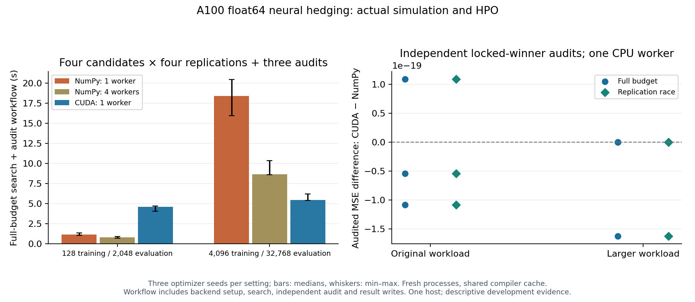

# CUDA simulation and HPO — A100, November 2026

The actual float64 neural-hedging search-plus-audit workflow takes **5.44s on CUDA**
versus **18.41s with one NumPy worker** and **8.65s with four** on this host. Median
paired speedups are **3.38×** and **1.58×** respectively for the larger workload.
The original small workload is faster on CPU, which remains the default.

This integrates simulation, neural forward/backward calculations, gradient clipping,
Adam, accounting, evaluation, ordinary `Study` scheduling, SQLite journaling, winner
locking, and independent winner audits. It does not extrapolate the earlier
fixed-input accounting sweep's speedup to training.



## Frozen protocol

Executed source **`f7d5669`**, verified against all 35 files in the manifest's source
map. The 30 campaigns run in fresh processes with 30 distinct process IDs, in the
saved deterministic order. Settings were fixed before comparative timing:

| Setting | Original workload | Larger workload |
| --- | ---: | ---: |
| Training paths per epoch | 128 | 4,096 |
| Evaluation paths | 2,048 | 32,768 |
| Epochs / trading intervals | 64 / 12 | 64 / 12 |
| Optimizer seeds | 31000, 31001, 31002 | same |
| Candidates per search | 4 | 4 |
| Full-budget replications per candidate | 4 | 4 |
| Racing checkpoints | 2, 4 | 2, 4 |
| Independent audits per locked winner | 3 | 3 |

The existing candidate sampler tunes width, learning rate, and regularization.
Each workload/seed runs full-budget and racing searches with NumPy/one worker and
CUDA/one worker, plus a NumPy/four-worker full-budget control. Every CPU worker uses
one BLAS thread. Audits use one worker for each backend. GPU campaigns run sequentially;
empty before/after GPU process snapshots do not establish continuous exclusive use.

Hardware/software: A100 PCIe 40GB, compute capability 8.0, driver 615.71.10,
CUDA 13.2.86, CuPy 14.2.0, NumPy 2.5.4, Python 3.12.3, Ubuntu 24.04. Detailed CPU,
compiler, library, environment, and device records are archived.

## Complete workflow results

Times below are medians across optimizer seeds. Speedups are calculated within
paired seeds first, then summarized; they need not equal ratios of displayed medians.

| Workload / scheduler | NumPy, 1 worker (s) | NumPy, 4 workers (s) | CUDA (s) | Paired speedup vs 1 worker | vs 4 workers |
| --- | ---: | ---: | ---: | ---: | ---: |
| Original / full budget | 1.155 | 0.816 | 4.616 | 0.283× | 0.172× |
| Larger / full budget | 18.414 | 8.646 | 5.443 | **3.383×** | **1.584×** |
| Original / race | 0.945 | — | 3.885 | 0.242× | — |
| Larger / race | 13.581 | — | 4.487 | **3.480×** | — |

The larger full-budget speedup ranges from **2.57–3.78×** versus one worker and
**1.39–1.92×** versus four. Whiskers in the figure show descriptive min–max across
seeds, not confidence intervals. CUDA is roughly 3.5× slower than one NumPy worker
on the original full-budget workload by the paired median. Small operations do
not amortize GPU execution and setup costs here.

The workflow clock starts before numerical imports and backend/context setup and
ends after completed device work and result writes. It includes host random-number
preparation, transfers, simulation, training, evaluation, scheduling, journals,
winner locking, and audits. Timing-file publication is outside that clock. The
parent additionally measures interpreter startup, imports, workflow, trailer, and
exit: larger full-budget process medians are **18.504s / 8.749s / 5.728s** for NumPy
one worker / four workers / CUDA. Paired process speedups are **3.230× / 1.522×**.

No objective warmup precedes a campaign. Fresh processes inherit the normal shared
CuPy disk cache, populated in part by correctness validation; these are not empty
JIT-cache measurements. CUDA context setup and module loading are included. Clocks,
thermals, CPU affinity, and host contention are uncontrolled. These are descriptive
results on one host, not p99 measurements, a fully tuned CPU comparison, or a
quality guarantee for other markets.

## Work and quality checks

- Full-budget searches execute 16 accepted objective calls each, plus three audits.
  Across all campaigns: **428 search observations + 90 audit observations**, zero
  objective failures and zero unsuccessful attempts.
- All 12 paired NumPy/one-worker and CUDA searches select the same winners. The six
  four-worker full-budget controls agree too. Racing allocation counts agree by
  seed: `12, 12, 10` for the larger workload and `14, 10, 12` for the original.
- All matched losses and all seven financial metrics satisfy the fixed development
  check `rtol=1e-6, atol=1e-8`. Maximum matched MSE difference is **2.17e-18**;
  maximum difference across any metric is **8.88e-16**, in mean turnover.
- Locked-winner audit mean differences are at most **1.63e-19** in absolute MSE.
  Audit training/scenario seeds use a namespace disjoint from search. Audit MSEs
  are about `4.2e-4` to `5.6e-4` in this synthetic market.
- CUDA uses the same NumPy initialization and shocks, uploaded once per objective;
  subsequent price formation, parameters, positions, accounting, gradients, and
  Adam moments stay on device. Host RNG is included in the runtime. The shared
  accounting kernel retains float64 arithmetic and original transaction-cost rules.

An independent data audit checked 731 finite JSON files, 60 SQLite journals,
518 metric files, all process identities, frozen order, and source hashes. The
summary regenerates exactly from unedited records. Three optimizer seeds and
three audits per winner provide development evidence, not a formal financial
non-inferiority conclusion. Adaptive runtime comparisons retain their observed
work counts separately from fixed-budget comparisons.

## Correctness and memory checks

- Local combined regression suite: **211 passed**, 18 GPU tests skipped on the CPU
  development host. On the A100 host: **59 integration tests passed**, two CPU-only
  optional-dependency checks skipped. Tests include full analytic/finite-difference
  gradients, 1/8/64-epoch parameter and metric agreement, stream handling, partial
  blocks, invalid arrays, no look-ahead, spawned search, and frozen-study resume.
- Rebuilt standalone executable: **117 correctness cases**, default Compute Sanitizer
  memcheck with **zero errors and zero leaked bytes**.
- Final integrated accounting/gradient/training memcheck: **14 tests passed**, zero
  errors and zero leaked bytes, using `--report-api-errors explicit` and releasing
  CuPy test pools before context teardown. See `final-workflow-memcheck.log`.

The initial default extended API mode reported cuBLASLt internal kernel lookups
and retained CuPy pool allocations at test teardown. A library-only control with
no project imports reproduced 48 lookup reports; releasing pools removed the
allocation reports. With explicit API reporting that control and the integrated
checks pass. This mode retains memory instrumentation and returned API errors
while excluding extended internal logging, as described in
[NVIDIA's reporting-mode documentation](https://docs.nvidia.com/compute-sanitizer/ComputeSanitizer/index.html).
The original reports, both controls, and their source are preserved in the raw
archive; the default extended integrated run is not reported as a pass.

## Reproduce and inspect

From the recorded source on a compatible CUDA development host:

```bash
python -m pip install -e '.[dev,benchmark,cuda13]'
python -m pytest tests/test_hedging.py tests/test_hedging_cuda.py \
  tests/test_study.py tests/test_cuda_workflow.py -q
compute-sanitizer --tool memcheck --report-api-errors explicit \
  --error-exitcode 99 --leak-check full python -m pytest tests/test_hedging_cuda.py \
  -k 'accounting or gradient or parameters_and_all_metrics' -q
bash cuda/run_tests.sh --output-dir /tmp/aster-workflow-validation --sanitizer required
python -m benchmarks.cuda_workflow run --output results/cuda-workflow-new
```

Use fresh output paths. The manifest records executed library versions. Regenerate
this figure with `python docs/evidence/cuda-workflow-2026-11-04/plot.py` and the
benchmark plotting dependencies installed. `records.json` and `summary.json`
provide direct access; `raw-records.tar.gz` includes every campaign's logs, metrics,
journals, winner, source identities, and validation reports. `validation.json`
records provenance; `SHA256SUMS` verifies the artifacts. The final integrated
memcheck log is stored separately alongside the archive.

See the [integration guide](../../CUDA_WORKFLOW.md),
[design](../../superpowers/specs/2026-11-04-cuda-workflow-design.md), and
[implementation plan](../../superpowers/plans/2026-11-04-cuda-workflow.md).
